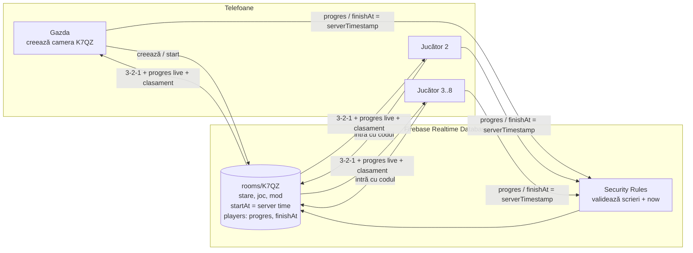

# Science Race — Specificație produs: jocuri științifice multiplayer

> Jocuri 3D pentru copii (5–11+ ani) în care 2–8 jucători intră într-o cameră cu un cod de 4 litere și se întrec pe niveluri științifice tot mai grele: **cine termină primul câștigă**. Fără AR, fără conturi, fără reclame.
> Platformă țintă: orice telefon sau tabletă (Android + iPhone), întâi în browser, apoi în store-uri.
> **„Science Race” e nume de lucru (placeholder)** — numele final al app-ului e încă nedecis.
> Înlocuiește direcția din `MVP_SPEC.md` (păstrat ca istoric). Decizii luate de SNAKE pe **21 oct 2026**. Fapte verificate la **21 oct 2026**; ce nu e verificat e marcat **(neverificat)**.

---

## 1. Viziune

- **Ce este:** Science Race (nume de lucru) e o colecție de jocuri-cursă științifice (circuite, lumină, pârghii, magneți etc.). Fiecare copil joacă **propria copie** a nivelului; contează doar timpul. Un nivel = o problemă scurtă (30 s – 3 min) care se rezolvă cu tap-tap.
- **De ce funcționează:** cursa îi aduce înapoi, problemele îi învață ceva real, iar părinții văd un joc educativ fără reclame și fără date colectate.
- **Ce s-a schimbat față de MVP_SPEC:**
  - **AR scos complet** (deocamdată). La test s-a văzut că ținutul telefonului în aer + tap precis într-o cursă e obositor și imprecis, mai ales pentru cei mici. Plus: WebXR AR nu merge pe iPhone.
  - **Partea „explorează / Full Lab” (experimente libere) e scoasă.** Rămân doar jocurile.
  - **Modelele realiste ale circuitului se păstrează** (baterie AA, bec cu sticlă și filament de wolfram, întrerupător-cuțit, clești crocodil cu dinți, fire cu toroane de cupru, placă de lemn — three.js, commit `cbfeac7` în https://github.com/szabolcsszikszaiolti-svg/ar-play-la).
- **Regula vizuală:** realist, nu cartoonish. Detaliile trebuie să reziste la **close-up** (copilul poate apropia camera 3D de orice piesă). Interfața (butoane, texte) poate fi prietenoasă și colorată; lumea 3D rămâne realistă.

---

## 2. Platformă și tehnologie

**Controlul:** scena 3D stă pe ecran; **un deget rotește camera** în jurul mesei, două degete fac zoom (opțional, nu e necesar pentru joc), **tap = selectează / conectează**. Tap și rotire se deosebesc printr-un prag de mișcare (~10 px) și de timp. Buton „🎯 Recentrează” readuce camera în poziția standard. Ținte de atingere mari (zona de 4–5 cm din prototipul circuitului rămâne principiul: tap pe capătul firului → se aprinde → tap pe bornă → se prinde singur).

| Opțiune | Android | iPhone | Pro | Contra |
|---|---|---|---|---|
| **Web (three.js) pe GitHub Pages** — acum | ✅ Chrome | ✅ Safari | Iterație în minute, link direct, deja avem modelele și pipeline-ul (GLB meshopt, texturi PBR CC0) | Fără plăți prin store; GitHub Pages e static (de aceea backend separat, §3) |
| **Capacitor** (web-ul împachetat într-o app nativă) | ✅ | ✅ | Același cod three.js; asset-urile sunt **incluse în app** (merge și offline pentru partea locală); plugin-uri pentru plăți în store | WebView-ul trebuie să ducă WebGL realist pe telefoane slabe (de testat); build/semnare/review |
| **TWA** (Trusted Web Activity) | ✅ | ❌ | Cel mai simplu drum în Google Play | Doar Android; e practic site-ul deschis în Chrome. Politica Google Play Families cere ca app-ul să **nu fie doar un webview al unui site** — risc de respingere (interpretarea noastră) |
| **Unity** | ✅ | ✅ | Motor de jocuri matur, performanță bună, servicii multiplayer proprii | Rescriem tot (modele refolosibile, cod nu); app mare; curbă de învățare |

### Recomandare
- **Acum:** web three.js pe GitHub Pages pentru prototip și playtest (merge imediat și pe iPhone).
- **Lansare în store-uri:** **Capacitor** pentru Android + iOS, cu asset-urile împachetate local și plăți prin Google Play Billing / Apple In-App Purchase. Apple cere ca app-urile să fie mai mult decât „un site reîmpachetat” (Guideline 4.2), deci app-ul trebuie să fie complet funcțional local (meniuri, niveluri, progres), nu un link spre site.
- **Unity** doar dacă la playtest WebView-ul nu duce grafica realistă pe telefoanele țintă.

**Buget de performanță (propunere, de validat pe telefoane mid/low-end):** modele GLB comprimate (meshopt, deja folosit), texturi max 1K pe telefon, `devicePixelRatio` limitat la 2, umbre de contact în loc de umbre dinamice multiple, 60 fps țintă / 30 fps minim. three.js inclus local, nu din CDN.

---

## 3. Arhitectura multiplayer

**Principiu:** sincronizăm **cursa**, nu fiecare mișcare. Fiecare telefon rulează și verifică nivelul local; serverul ține camera, ora oficială de start, progresul și timpii de final.

### Flux
1. Un copil apasă **„Creează cameră”** → primește un cod de 4 litere (ex. **K7QZ**; fără litere ușor de confundat: O/0, I/1).
2. Ceilalți apasă **„Intră”** și tastează codul. **2–8 jucători.**
3. Fiecare își alege **porecla** (dintr-o listă generată, vezi §10) și **grupa de vârstă** (§5).
4. Gazda alege jocul și modul (**Eliminare** sau **Puncte**, §4) și apasă „Start”.
5. Serverul scrie ora de start în viitor (ex. +4 s); toți văd **3-2-1** sincronizat după ceasul serverului.
6. În timpul nivelului fiecare telefon trimite doar progresul (ex. „Ana: 2/4 fire”) — afișat live sub forma unor bare.
7. La rezolvare, telefonul scrie „terminat” cu **timestamp de server**; serverul ordonează, se afișează clasamentul.
8. Următorul nivel / eliminare / podium final → **„Mai jucăm o dată”** (aceeași cameră) sau ieșire. Camera se **șterge** la final.

### Anti-cheat (realist pentru copii)
- **Ceasul oficial e al serverului:** `startAt` și `finishAt` sunt scrise cu `serverTimestamp()`; timpul = `finishAt − startAt`. Schimbarea orei pe telefon nu ajută. Regulile de securitate pot cere ca valoarea scrisă să fie exact `now` (ora serverului).
- Fiecare jucător poate scrie **doar în nodul lui**; `finishAt` se poate scrie o singură dată și doar după `startAt`.
- **Limită:** verificarea soluției se face pe telefon, deci un copil cu unelte de developer ar putea trimite „terminat” fals. Pentru o validare pe server ar trebui Cloud Functions (doar pe planul Blaze, plătit pe consum). Pentru prototip acceptăm riscul; adăugăm un timp minim plauzibil per nivel (sub el → rezultat invalid).
- **Deconectare:** `onDisconnect()` marchează jucătorul ca plecat; nu blochează cursa.

### Firebase Realtime Database vs Supabase Realtime (free tier, verificat 21 oct 2026)

| | **Firebase RTDB — Spark (gratuit)** | **Supabase — Free** |
|---|---|---|
| Conexiuni simultane | **100** | **200** |
| Mesaje | nu e limită de mesaje; **10 GB/lună** descărcare, **1 GB** stocare | **2 milioane/lună**, **100 mesaje/s**, 5 GB egress |
| Ora serverului | ✅ `serverTimestamp()`, `.info/serverTimeOffset`, `now` în reguli | Prin Postgres (`now()`), dar Broadcast/Presence nu pun timestamp de server automat — mai mult cod |
| Curățare la deconectare | ✅ `onDisconnect()` pe server | Presence (cu limite: 20 mesaje presence/s pe Free) |
| Inactivitate | proiectul nu se oprește (neverificat explicit pentru Spark) | **Proiectul Free e pus pe pauză după 1 săptămână de inactivitate** |
| Scalare | Blaze: până la **200K** conexiuni / bază, plătit pe consum (1 GB stocat, apoi $5/GB; 360 MB/zi descărcare, apoi $1/GB) | Pro: de la **$25/lună**, 500 conexiuni incluse |
| Fără build | ✅ SDK modular ES din CDN, merge pe GitHub Pages | ✅ la fel |

**Recomandare: Firebase Realtime Database.** Ora de server și `onDisconnect` rezolvă direct exact ce ne trebuie (start sincron, ceas oficial, curățare), iar regulile pot valida `now`. 100 de conexiuni simultane pe Spark înseamnă ~12 camere pline de 8 sau ~25 camere de 4 jucători **în același timp** — suficient pentru prototip și playtest; la lansare trecem pe Blaze. Supabase rămâne alternativa dacă vrem SQL; pauza după o săptămână de inactivitate e incomodă pentru un prototip testat sporadic.

**Identitate tehnică:** pentru reguli e nevoie de un ID per sesiune — Firebase Anonymous Auth (fără email, fără nume). Datele bazei: alegem o regiune europeană la creare **(de verificat ce regiuni oferă RTDB)**. Fără Firebase Analytics / Crashlytics în app.

**Ștergerea camerelor:** gazda șterge camera la final; jucătorii se șterg la deconectare; regulile permit oricui să șteargă camere mai vechi de 2 ore (curățare fără server propriu).

---

## 4. Moduri de joc și scor

Gazda alege modul **pentru fiecare joc**, înainte de start.

### 4.1 Eliminare
- **Minim de jucători (decis 21 oct 2026):** cu **2 jucători** nu se elimină nimeni după un singur nivel — se joacă **cel mai bun din 3 (1v1)**: primul care câștigă 2 niveluri câștigă meciul. Cu **3 sau mai mulți** jucători se aplică eliminarea de mai jos.
- După fiecare nivel, **cel mai lent iese** (timp relativ, §4.3). Runde = **jucători − 1** (6 jucători → 5 runde: 6→5→4→3→2→finală 1v1; 4 jucători → 3 runde; 8 → 7; 3 → 2).
- Nivelurile **se îngreunează pe măsură ce rămân mai puțini**; finala e cea mai grea (în grupa de vârstă a fiecăruia, §5).
- **Limită de timp per nivel:** cine nu termină în timp iese automat (dacă nu termină nimeni, iese cel cu cel mai puțin progres; dacă și acolo e egal — timpul ultimului pas făcut).
- **Eliminații nu pleacă:** rămân **spectatori** (văd barele de progres live), pot **ghici câștigătorul rundei** pentru un bonus (stea/insignă, nu influențează meciul) și pot **juca nivelul după rundă** ca să câștige stele.

### 4.2 Puncte
- Toți joacă toate nivelurile; puncte după loc la fiecare nivel. Propunere (de reglat la playtest):

| Loc | 1 | 2 | 3 | 4 | 5 | 6–8 | Neterminat |
|---|---|---|---|---|---|---|---|
| Puncte | 10 | 7 | 5 | 3 | 2 | 1 | 0 |

  (Pentru 4 jucători: 10/7/5/3, cum am stabilit.)
- Locul la fiecare nivel se stabilește după **timpul relativ** (§4.3).
- **Egalitate la total:** câștigă **suma cea mai mică a timpilor relativi** (calculați din milisecunde, ora serverului) — practic nu există egalitate.
- **Opțional „moarte subită”:** un nivel bonus scurt doar pentru cei la egalitate; primul care termină câștigă.

### 4.3 Comun
- Lungimea unui meci în Puncte: 3, 5 sau 7 niveluri (gazda alege).
- **Vârste amestecate — regula decisă (21 oct 2026):** fiecare joacă versiunea grupei lui (§5), iar clasamentul (Puncte și Eliminare) folosește **timpul relativ** = timpul real ÷ **timpul-reper (par) al nivelului pentru grupa jucătorului**, nu timpul brut. Exemplu: un copil Mic termină în 60 s cu par 50 s → 1,20× par; un copil Mare termină în 40 s cu par 30 s → 1,33× par; câștigă cel Mic. Timpul real se măsoară tot pe ora serverului (§3); timpul relativ e calculat din el. Par-urile per nivel și grupă se stabilesc la playtest. Regula se aplică la fel și când toți sunt în aceeași grupă (rezultatul e același ca la timpul brut).

---

## 5. Grupe de vârstă

Fiecare jucător își alege grupa (nu e verificată, nu e stocată după meci).

| Grupa | Ce primește |
|---|---|
| **Mici (5–7)** | Puține piese, ținte mari, **ajutor vocal în română**, mai mult timp, săgeată-ghid, iconițe în loc de text |
| **Mijlocii (8–10)** | Ordinea normală a nivelurilor, indicii mai puține |
| **Mari (11+)** | Capcane, provocări-mister, cronometru strâns, fără indicii |

- **Dificultatea vine din numărul de piese, timp și indicii — nu din concepte pe care nu le-au învățat.** Exemplu: serie vs paralel e materie de clasa a III-a–a IV-a (aprox.); un copil de 5–7 ani primește „închide cercul” cu 2–3 piese, nu serie/paralel.
- Un copil de 6 ani se poate întrece cu fratele de 10: fiecare pe versiunea lui. **Decis (21 oct 2026):** clasamentul se face după timpul raportat la timpul-reper (par) al grupei fiecăruia (§4.3), deci fiecare grupă are par-uri proprii pentru fiecare nivel.
- Ajutorul „Ajută-mă” (din prototipul circuitului) rămâne: la Mici e gratuit; la Mijlocii/Mari costă timp (ex. +10 s) într-o cursă (propunere).

---

## 6. Catalogul de jocuri

Toate: niveluri care se îngreunează, cel mai rapid câștigă, interacțiune tap-tap, obiecte realiste pe o masă de lucru. Scările de mai jos sunt pentru grupa Mijlocii; Mici = mai puține piese, Mari = capcane + timp strâns.

| # | Joc | Ce face copilul | Scara de niveluri (scurt) | Ce învață |
|---|---|---|---|---|
| 1 | **Cursa circuitelor** ⭐ primul | Conectează fire, baterii, becuri, întrerupătoare | Vezi §7 (7 niveluri) | Circuit închis, conductori, serie/paralel |
| 2 | **Lumină și oglinzi** | Rotește oglinzi (tap = +45°/+15°) ca laserul să lovească ținta | 1 oglindă → 3 oglinzi → obstacole → prismă (descompune culorile) → filtre de culoare (ținta cere roșu) → țintă în mișcare | Reflexie, unghiuri, culori |
| 3 | **Echilibru și pârghii** | Pune greutăți pe un balansoar până e drept | Greutăți egale → distanțe diferite → mai multe greutăți → pârghie pentru a ridica o piatră → scripeți | Pârghia, moment (greutate × distanță) |
| 4 | **Rampa și bila** | Pune rampe, arcuri, ventilatoare ca bila să ajungă în pahar | 1 rampă → 2 rampe + gol → arc → ventilator → suprafețe cu frecare diferită → obstacole mobile | Gravitație, viteză, frecare, energie |
| 5 | **Magneți** | Pune / întoarce magneți ca bila de metal să iasă din labirint | Atracție simplă → atracție + respingere → magneți ficși care încurcă → magneți de forțe diferite → materiale nemagnetice | Atracție/respingere, ce e magnetic |
| 6 | **Plutește sau se scufundă** | Încarcă o barcă cu cât mai multă marfă fără s-o scufunzi | Obiecte ușoare/grele → distribuția încărcăturii → apă dulce vs sărată (sărată duce mai mult) → forme de barcă → încărcătură maximă cronometrată | Plutire, densitate |
| 7 | **Laboratorul de chimie** | Amestecă lichide până ajunge la culoarea / pH-ul cerut | 2 lichide → indicator de pH (varză roșie) → 3 lichide în proporții → reacție cronometrată (ex. bule care se opresc) → țintă exactă de pH | Acid/bază, amestecuri, reacții |
| 8 | **Țevi și apă** | Rotește/pune țevi ca apa să ajungă la plante | Drum simplu → ramificații → robineți → presiune (apa nu urcă prea sus) → scurgeri de reparat → mai multe plante în ordine | Curgere, presiune, sisteme |

Realismul la close-up se aplică la fiecare (sticlă, metal, apă, lichide cu refracție). Jocurile 7 și 8 (lichide) sunt cele mai scumpe vizual — le planificăm ultimele.

---

## 7. Cursa circuitelor — în detaliu

### 7.1 Piese (refolosite din `cbfeac7`, adaptate pentru 3D)
Placă de lemn, baterie AA în suport (bornă + / −), bec cu glob de sticlă și filament spiralat (gri stins → roșu → alb-galben aprins, lumina caldă pe lemn), întrerupător-cuțit, fire cu clești crocodil (dinți, manșoane, toroane de cupru). De adăugat: al doilea/al treilea bec, motor mic cu elice, buzzer, fir „rupt” (izolație crăpată, cupru tăiat vizibil la close-up).

### 7.2 Interacțiune
- **Tap pe capătul unui fir** → se evidențiază (verde). **Tap pe o bornă / șurub** → cleștele se prinde singur cu animație și „clic”.
- **Tap pe un clește deja prins** → îl desprinde.
- **Tap pe întrerupător** → se închide/deschide.
- Fără drag precis. Ținte mari, magnetism la cea mai apropiată bornă.

### 7.3 Verificarea soluției
Circuitul e un graf (borne = noduri, fire/piese = muchii). Un mic solver rezistiv calculează curentul prin fiecare bec → luminozitatea (serie = mai slab, paralel = plin). Nivelul e rezolvat când condiția nivelului e adevărată (ex. „becul A aprins plin”). **Scurtcircuit** (fir direct pe baterie): bateria „se încălzește” (avertizare vizuală + mesaj de siguranță „Nu face asta cu bateria adevărată!”), nu e penalizare dură. Progresul afișat = conexiuni corecte / conexiuni necesare.

### 7.4 Scara de niveluri

| # | Nivel | Mici (5–7) | Mijlocii (8–10) | Mari (11+) |
|---|---|---|---|---|
| 1 | Baterie + bec | 2 fire, bornele luminează | 2 fire | 2 fire + 2 fire în plus inutile |
| 2 | + întrerupător | săgeată spre întrerupător | trebuie închis la final | întrerupătorul pornește deschis și e ascuns după alte piese |
| 3 | 2 becuri în serie (mai slabe) | — (înlocuit: 2 becuri, ghidat) | „Aprinde ambele becuri” | cerință: „becurile să lumineze slab” |
| 4 | 2 becuri în paralel (plin) | — | „Aprinde-le pe amândouă la fel de tare ca unul singur” | + întrerupător pe o singură ramură |
| 5 | Găsește defectul | bec ars evident (filament rupt) | fir rupt **sau** baterie întoarsă | două defecte simultan |
| 6 | Bec + motor / buzzer | motor singur | bec + motor | bec + buzzer, buzzer doar cu întrerupătorul închis |
| 7 | Provocare-mister | — | „Aprinde 2 din 3 becuri cu un singur întrerupător” | variantă cu un singur fir disponibil |

„—” = la Mici nivelul e înlocuit cu o variantă din nivelurile 1–2 cu alt aranjament (fără concepte noi). Timpii-limită și timpii-reper (par) per nivel și grupă **se stabilesc la playtest** (nu avem încă date).

### 7.5 Ce trebuie să reziste la close-up
Filamentul în interiorul globului (fără pete albe parazite), eticheta bateriei orientată corect, manșoanele cleștilor proporționale (probleme deja notate în versiunea AR), lumina caldă a becului pe lemn, firul rupt vizibil ca defect real.

---

## 8. Recompense (doar în joc)

- **1–3 stele pe nivel** după timp (față de par-ul grupei). Stelele deblochează niveluri de antrenament și cosmetice.
- **Insigne:** „Electrician”, „Fulgerul” (cel mai rapid din cameră), „Fără greșeli”, „Profet” (a ghicit câștigătorul ca spectator).
- **Cosmetice:** culori de fire, bec special (ex. filament vintage), plăci/mese diferite (stejar, ardezie), skin-uri de laborator. **Doar aspect, zero avantaj.**
- **Podium 3D** la final: trofeu realist pe masă pentru câștigător, locurile 2–3 pe podium.
- **Interzis:** avantaje plătite, loot box-uri, monedă virtuală cumpărată cu bani reali, reclame.
- Progresul (stele, insigne, cosmetice) e **salvat doar local pe dispozitiv** (fără cont). Dacă se șterge app-ul, se pierd — acceptat (vezi Întrebări deschise).

---

## 9. Monetizare

- **Gratuit:** 1–2 jocuri + primele niveluri (ex. Cursa circuitelor niveluri 1–3).
- **O singură plată** deblochează toate jocurile — prin **Google Play Billing** / **Apple In-App Purchase**. Nu e nevoie de cont la noi: cumpărătura e legată de contul de store al părintelui și se **restaurează** din store. Apple cere explicit folosirea In-App Purchase pentru deblocarea unei versiuni complete și un mecanism de restaurare (Guideline 3.1.1).
- **Bucla virală:** dacă **gazda camerei** are versiunea completă, prietenii intră în acel joc gratis. **(Neverificat dacă e acceptat explicit de Apple/Google — de confirmat la review; ca mecanism seamănă cu „friend pass” din alte jocuri.)**
- **Mai târziu:** pachete noi de jocuri (cumpărate separat); **licențe pentru școli/clase** cu **mod profesor** (profesorul creează camera, toată clasa se întrece). Apple permite metode de plată în afara IAP pentru vânzări directe către organizații (3.1.3(c)), dar vânzările către familii trebuie să treacă prin IAP.
- **Poartă pentru părinți** în fața oricărei cumpărări și a oricărui link extern (§10).
- **Prețuri: nedecise** — nu propunem cifre fără o analiză a pieței.
- Pe web (GitHub Pages) nu există plăți; web-ul rămâne demo/prototip.

---

## 10. Siguranța copiilor și legislație

### Design
- **Fără conturi, fără login, fără date personale.** Nu cerem nume, email, vârstă exactă, locație, foto, microfon.
- **Porecle generate, nu text liber:** copilul alege din combinații predefinite (ex. „Vulpea Albastră”, „Becul Rapid”). Astfel nu poate scrie numele real, adresa sau cuvinte urâte — și evităm ca jocul să devină „social feature” cu schimb de informații libere.
- **Fără chat.** Eventual doar reacții predefinite (👏 🔥) — de decis.
- **Camerele sunt efemere:** se șterg la finalul jocului (și automat după 2 h). Nu păstrăm istoricul meciurilor.
- **Fără SDK-uri de analytics sau reclame** (inclusiv Firebase Analytics). Grupa de vârstă e trimisă în cameră doar cât durează meciul.
- **Coduri de cameră:** 4 litere = ~390.000 combinații (cu alfabet de 25 litere) — cineva ar putea ghici un cod. Gazda vede cine intră și poate elimina un jucător; camera se închide la start.
- **Sesiuni sănătoase:** meciuri de 5–10 min, sugestie de pauză după mai multe meciuri, fără notificări push.

### Store-uri (verificat 21 oct 2026)
- **Apple Kids Category (Guideline 1.3):** fără linkuri în afara app-ului, oportunități de cumpărare sau alte distrageri, **decât într-o zonă protejată de parental gate**; fără analytics de terță parte și fără reclame de terță parte (cu excepții limitate); nu trimite informații personale sau despre dispozitiv către terți. Benzile de vârstă Kids: **5 și sub, 6–8, 9–11** — grupa noastră „11+” iese parțial din ele (de decis la publicare). Guideline 5.1.4: atenție la COPPA/GDPR; parental gate ≠ consimțământ parental pentru date. Termenii „For Kids”/„For Children” în metadata sunt rezervați categoriei Kids (2.3.8).
- **Google Play Families:** fără ID de publicitate (AAID) și alți identificatori de dispozitiv pentru app-uri doar pentru copii; doar SDK-uri aprobate pentru servicii pentru copii; reclamele (dacă ar exista) doar prin SDK-uri certificate Families, fără reclame personalizate; **monetizarea nu are voie să fie înșelătoare sau făcută pentru tap-uri accidentale** și trebuie să distingă clar monedele din joc de banii reali; funcțiile sociale cu schimb de informații personale cer „adult action” (PIN, parolă, dată de naștere etc.); app-ul **nu trebuie să fie doar un webview al unui site**; trebuie respectate COPPA și GDPR. Politica Families **nu numește explicit** „parental gate” pentru cumpărături (Apple da); o folosim oricum, ca „adult action” (ex. o întrebare pe care un copil de 5–8 ani nu o rezolvă, nu un simplu buton).
- **Parental gate propus:** ex. „Scrie anul în care s-a născut un părinte” / o înmulțire de 2 cifre / ținut apăsat 3 s + întrebare; pentru copiii care nu citesc, mesaj vocal „Cheamă un adult”.

### Legislație
- **COPPA (SUA):** Regula amendată de FTC a fost publicată pe 22 aprilie 2025, a intrat în vigoare pe **23 iunie 2025**, cu termen de conformare **22 aprilie 2026** (cu excepția § 312.11(d)(1), (d)(4) și (g)) — se aplică deja. Amendamentele cer consimțământ parental separat pentru dezvăluirea datelor către terți, politică scrisă de retenție și program de securitate a informațiilor. **De clarificat cu un jurist:** dacă ID-ul anonim de sesiune Firebase (persistent identifier) intră sub excepția „support for internal operations” și dacă Firebase, ca procesator, contează drept „terț” pentru Apple 1.3. Poreclele generate + ștergerea camerelor reduc mult riscul.
- **GDPR art. 8 (UE):** consimțământ parental necesar sub vârsta stabilită de fiecare stat (13–16 ani). **În România vârsta este 16 ani** (Legea 190/2018 nu modifică art. 8, deci se aplică pragul implicit). Toată ținta noastră e sub prag; prin design „fără date personale” evităm nevoia de consimțământ. **Privacy policy scurtă și clară** totuși obligatorie (și cerută de ambele store-uri).

---

## 11. Primul prototip

**Scop:** validăm că o cursă multiplayer pe circuite e distractivă și corectă, cu 2–4 copii reali.

**Include:**
- Web three.js pe GitHub Pages (același repo), fără AR. Circuitul existent mutat pe o scenă 3D cu rotire cu degetul + tap-tap.
- **Camere:** creează / intră cu cod de 4 litere, **2–4 jucători**, porecle generate, alegere grupă (doar **Mijlocii** implementată la început).
- **Start sincron 3-2-1** pe ora serverului, **progres live** („Ana: 2/4 fire”), **clasament** după fiecare nivel, **„Mai jucăm o dată”**.
- **3 niveluri:** baterie + bec; + întrerupător; 2 becuri în serie.
- **Ambele moduri:** cu 4 jucători, Eliminarea are exact 3 runde = cele 3 niveluri, iar cu 2 jucători „cel mai bun din 3” folosește tot cele 3 niveluri (cu 3 jucători: 2 runde), deci e ieftin de adăugat peste Puncte. Dacă ceva se complică, **Puncte primul**.
- Firebase RTDB Spark, reguli de securitate (scriere doar în nodul propriu, `finishAt` = `now`, o singură dată), ștergerea camerei la final.
- Podium simplu la final.

**Nu include (încă):** grupele Mici/Mari, ajutor vocal, stele/insigne/cosmetice salvate, alte jocuri, plăți, Capacitor, parental gate.

**Criterii de succes:** 3 meciuri la rând fără desincronizare; diferența de start între telefoane imperceptibilă; copiii înțeleg tap-tap fără explicații în < 30 s; vor „încă o dată”.

---

## 12. Milestone-uri orientative

| # | Durată | Livrabil |
|---|---|---|
| M0 | săpt. 1 | Circuitul mutat pe 3D fără AR (rotire + tap-tap, recentrare), fixurile de close-up rămase; joc single-player cu 3 niveluri + cronometru |
| M1 | săpt. 2 | Firebase: camere, cod, lobby, 3-2-1, progres live, clasament, mod Puncte + Eliminare; test cu SNAKE + 1–3 persoane |
| M2 | săpt. 3 | Playtest cu 2–4 copii; reglaj timpi-limită/par; nivelurile 4–7 ale circuitului |
| M3 | săpt. 4–5 | Grupele Mici și Mari, ajutor vocal în română, stele + insigne locale, podium 3D |
| M4 | săpt. 6–7 | Al doilea joc: **Lumină și oglinzi** (decis 21 oct 2026) — laser realist, oglinzi rotite cu tap, primele niveluri (1 → 3 oglinzi, obstacole), par-uri per grupă |
| M5 | săpt. 8–9 | Capacitor (Android + iOS), plăți în store, parental gate, privacy policy, test pe telefoane slabe |
| M6 | săpt. 10 | Beta intern (Play Internal Testing + TestFlight), pregătire Families / Kids Category |

Durate estimative, nevalidate.

---

## 13. Întrebări deschise

### Decise (21 oct 2026)
- **Nume de lucru:** „Science Race” (placeholder), folosit în tot documentul; numele final rămâne de ales (vezi întrebarea 2).
- **Vârste amestecate:** clasamentul folosește timpul raportat la timpul-reper (par) al grupei fiecăruia (§4.3, §5).
- **Eliminare cu 2 jucători:** se joacă „cel mai bun din 3” (1v1); de la 3 jucători în sus, eliminarea normală (§4.1).
- **Al doilea joc:** Lumină și oglinzi (§12, M4).

### Încă deschise
1. **Vulcanul:** îl scoatem complet sau îl păstrăm ca mic demo 3D (ex. ecran de încărcare / „trofeu” vizual)?
2. **Numele final al app-ului și repo-ul:** „Science Race” e doar placeholder. Ce nume final? Repo nou sau continuăm în `ar-play-la`?
3. **Bucla „gazda are full → prietenii joacă gratis”:** acceptată de Apple/Google? De confirmat înainte de lansare.
4. **Progres doar local:** e OK că stelele/cosmeticele se pierd la reinstalare, sau oferim o salvare fără cont (ex. cod de recuperare)?
5. **Reacții predefinite în cameră** (👏 🔥) — da sau nu?
6. **Grupa 11+ vs Apple Kids Category** (benzi până la 9–11): publicăm în Kids (cu restricțiile lui) sau ca joc general cu rating 4+?
7. **Firebase ca procesator + ID anonim** — confirmare juridică COPPA/GDPR și față de Apple 1.3.
8. **Prețul** versiunii complete și al licențelor pentru școli — nedecis.
9. **Capacitor vs Unity:** decizia finală după testul de performanță al graficii realiste în WebView pe telefoane slabe.

---

## Surse (verificate 21 oct 2026)
- Firebase — prețuri (Spark: RTDB 100 conexiuni simultane, 1 GB stocare, 10 GB/lună descărcare; Blaze: 200K conexiuni/bază, $5/GB stocat, $1/GB descărcat): https://firebase.google.com/pricing ; limite RTDB: https://firebase.google.com/docs/database/usage/limits
- Firebase — `onDisconnect`, `serverTimestamp()`, `.info/serverTimeOffset`: https://firebase.google.com/docs/database/web/offline-capabilities ; limbajul regulilor (`now`): https://firebase.google.com/docs/rules/rules-language
- Supabase — limite Realtime (Free: 200 conexiuni, 100 mesaje/s, 20 mesaje presence/s): https://supabase.com/docs/guides/realtime/limits ; prețuri (Free: 2M mesaje/lună, pauză după 1 săptămână inactivitate; Pro de la $25/lună): https://supabase.com/pricing ; Broadcast: https://supabase.com/docs/guides/realtime/broadcast
- Apple — App Review Guidelines (1.3 Kids Category, 2.3.8, 3.1.1 In-App Purchase + restaurare, 3.1.3(c), 4.2, 5.1.4 Kids; actualizat 16 oct 2026): https://developer.apple.com/app-store/review/guidelines/
- Apple — Kids apps, parental gates, benzi de vârstă Kids, Ask to Buy: https://developer.apple.com/app-store/kids-apps/
- Google Play — Families Policies (date, SDK-uri, reclame, monetizare, social features / adult action, „nu doar webview”): https://support.google.com/googleplay/android-developer/answer/9893335?hl=en
- Google Play Billing: https://developer.android.com/google/play/billing
- Capacitor: https://capacitorjs.com/docs ; TWA: https://developer.chrome.com/docs/android/trusted-web-activity ; RevenueCat pentru Capacitor (opțional, terț — de evaluat pentru Kids): https://www.revenuecat.com/docs/getting-started/installation/capacitor ; Unity Gaming Services: https://docs.unity.com/ugs/en-us/manual/overview/manual/unity-gaming-services-home
- FTC — COPPA Rule amendată (Federal Register, 22 apr 2025; în vigoare 23 iun 2025; conformare 22 apr 2026): https://www.federalregister.gov/documents/2025/04/22/2025-05904/childrens-online-privacy-protection-rule
- GDPR art. 8: https://gdpr-info.eu/art-8-gdpr/ ; vârsta de consimțământ digital în România = 16 ani: https://euconsent.eu/digital-age-of-consent-under-the-gdpr/ și https://childreninthedigitalworld.twobirds.com/home/romania ; Legea 190/2018: https://legislatie.just.ro/Public/DetaliiDocument/203151
